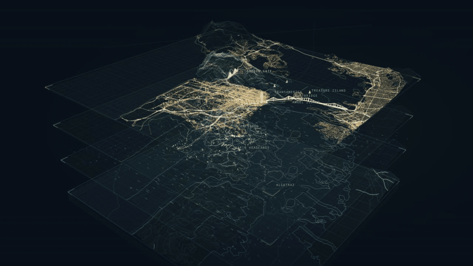

# Bay Layers

[Live scene](https://anselm.github.io/bay-area-twin/) · [Backdrop widget](https://anselm.github.io/bay-area-twin/?backdrop=1) · [Embed examples](https://anselm.github.io/bay-area-twin/embed.html)



A wide, luminous, interactive portrait of San Francisco Bay that explains the idea of a digital twin through four shared geographic layers: earth and seabed, natural forces, living systems, and the built world.

## Run

No installation or API key is required. Three.js 0.180.0 and OrbitControls are vendored with the upstream MIT license.

```sh
npm run dev
```

Open http://127.0.0.1:4177. Any ordinary static server can serve `dist/`.

## Explore

- Drag to orbit, scroll/pinch to zoom, right-drag to pan.
- Select a layer to emphasize it; select again to show the full stack.
- Use separation or Bring together to assemble the systems onto shared geography.
- Scrub the day/night cycle or pause motion. Space pauses when focus is outside a control; number keys 1–4 select layers; Escape clears layer focus.
- Behind the layers describes sources and the distinction between mapped and illustrated systems.
- `?backdrop=1` hides the interface and retains motion and place annotations, with a 30 fps cap. `?embed=1` provides a compact interactive header. `embed.html` gives an iframe example.
- Reduced-motion preference starts paused with orbit off; the user can start it explicitly.

## Data and honesty

`dist/assets/sources.json` is the source manifest. The downloaded NOAA F32 elevation/bathymetry grid is real, with historical and mixed-datum sources, resampled to 513×513. The terrain mesh uses 129×129 vertices. Its vertical scale is intentionally exaggerated.

Building footprints/heights are simplified from a bounded 20,000-feature San Francisco municipal-source sample served through a public ArcGIS mirror. A spatial sampling step retains 9,983 rendered buildings. They are footprint extrusions, not photogrammetric facades. A further 6,592 spatially sampled OpenStreetMap footprints cover the visible surrounding land, including western East Bay and Marin communities. Regional height coverage is incomplete; missing heights use a clearly documented two-storey display default.

Street centerlines and 8,000 historical street-tree points come through public mirrors of municipal records. These are partial historical snapshots. SF park vegetation sketches, animal tracks, utility routes, vehicle movement, solar changes, wind and currents are illustrative, not live observations or calibrated forecasts. Golden Gate/Bay Bridge and landmark silhouettes are geographically positioned but artistically constructed.

This is a visual explanation of a twin's component systems, not an operational predictive Bay Area twin. Data provenance remains available within the interface rather than being implied by realistic motion.

## Architecture

- Buildless ES modules, Three.js WebGL2, merged building/line geometries, batched particles, shared coordinates and deterministic procedural sketches.
- All geographic data and geometry are bundled snapshots; no runtime map API, analytics, or external CDN calls. Compressed geometry loads in parallel; the terrain appears before the city finishes assembling. Rendering pauses offscreen and in hidden tabs.
- `dist/main.js`: scene, geographic transforms, render batches, motion and controls.
- `dist/style.css`: wide hero, mobile and compact embed layouts.
- `scripts/fetch-data.py`, `fetch-features.py`, `prepare-data.py`: reproducible bounded data acquisition and reduction, with raw request URLs cached locally. Python with Pillow and NumPy is required only to rebuild data.

Three.js was chosen to keep iteration focused on the composition, data and interaction. It can also support a later WebGPU renderer. Moving this custom GLSL-free scene to the WebGPU/TSL material stack would still require compatibility testing. Raw WebGPU is not currently justified by measured performance needs; it remains an option if compute-heavy model coupling becomes central.

## Useful next passes

1. Broader spatial building coverage and more carefully modeled landmarks.
2. Real regional canopy/landcover instead of forest sketches; current tree data where available.
3. Observed weather and tide snapshots, each with timestamps and uncertainty.
4. A small explicit intervention with a documented model and feedback path.
5. Profiling on target embedded/mobile devices before choosing a WebGPU migration or tiled streaming strategy.

## Life in the layers

The built layer includes brighter moving city headlights, two-way bridge traffic, three quiet sailboats, and a schematic twin-bore BART crossing with moving trains. Selecting the built layer emphasizes the crossing and reveals its label. The living layer includes an occasional whale silhouette and a short surface ripple/spout. These motions are intentionally expressive rather than time-realistic. They pause with the shared playback control. The BART alignment/depth is approximate and animal movement is not tracking data.

## Static data preparation

Visitors fetch only files from this site. NOAA and ArcGIS are contacted only when deliberately refreshing the saved snapshots; development and deployment do not refetch them.

```sh
# Optional: refresh downloaded snapshots (Python, Pillow and NumPy required).
npm run data:fetch
# Reduce the snapshots and prebuild packed city geometry and terrain contours.
npm run data:prepare
# Or rebuild geometry alone from the existing prepared data.
npm run prepare:geometry
```

Commit the prepared `dist/assets/` files with the site. Raw downloads are cached under `scripts/cache/` and excluded from source control. The browser uses gzip assets with native decompression, with uncompressed equivalents for older browsers. Data are historical samples, not live feeds. The backdrop's wind, traffic, fog, animals and day/night cycle are illustrative. Decorative building lights fade with the day/night cycle.

## Hydrography

`python3 scripts/fetch-hydrography.py` saves a bounded EPA WATERS NHDPlus V2 stream snapshot. This reuses the Water Atlas source approach, retaining smaller streams instead of its order ≥ 4 selection. The cyan channels follow the terrain in the earth layer. Medium-resolution mapped channels include intermittent streams and are not live flow measurements. Ocean grid lines and the survey-block walls are deliberately faint to let channels and coastlines carry the geography.

## Regional living and built coverage

`python3 scripts/fetch-vegetation.py` prepares a Marin vegetation grid from the California wildlife agency mirror of the Marin Fine Scale Vegetation Map. Requires Pillow. The 2018 landscape classification and 2019 LiDAR mean stand heights distinguish forest, shrub and herbaceous patches. Dots sample mapped polygons, not individual tree positions. SF street trees remain a separate historical point inventory; SF park sketches remain illustrative.

`python3 scripts/fetch-regional.py` downloads a bounded OpenStreetMap roads/buildings snapshot. Run `npm run prepare:geometry` afterward. Regional footprints outside SF are spatially sampled. Heights use OSM height/levels when present, otherwise an illustrative 6.2m default. Regional roads supplement the SF sample; major routes receive greater brightness. © OpenStreetMap contributors, ODbL 1.0. The frame includes only western Oakland/Berkeley, not those entire cities. Everything remains static at runtime.

## Develop and push updates

```sh
git clone https://github.com/anselm/bay-area-twin.git
cd bay-area-twin
npm run dev
# Edit, then check and publish source updates:
npm run check
git add .
git commit -m "Describe the change"
git push origin main
```

Prepared files in `dist/` are tracked: a fresh clone needs no dependency installation, data download or build. Raw downloads, local environment files and caches are ignored. The current maintainer checkout may use a `github` remote instead of `origin`; in that case use `git push github main`. GitHub Pages redeploys automatically after pushes to `main`.

The `.openai/hosting.json` file records an additional existing Sites deployment; it contains an identifier, not credentials, and GitHub Pages does not use it. Three.js retains its upstream MIT license. Dataset rights are separate: preserve source provenance and OpenStreetMap's ODbL attribution. This repository does not yet assign a license to the project's own code.

## Enable GitHub Pages

In GitHub repository **Settings → Pages → Build and deployment → Source**, choose **GitHub Actions**. The included `.github/workflows/pages.yml` publishes `dist/` on pushes to `main`; it never contacts NOAA, ArcGIS or Overpass. For the suggested repository, the default project URL will be:

`https://anselm.github.io/bay-area-twin/`

Run the workflow manually from Actions if the first push happened before Pages was enabled. A custom domain can change the resulting URL; GitHub's Pages settings show the actual published address.

## Use as a wiki backdrop

Use the **Pages URL**, not a github.com source link or raw.githubusercontent.com URL. On the wiki page:

```html
<section class="twin-hero">
  <iframe
    class="twin-backdrop"
    src="https://anselm.github.io/bay-area-twin/?backdrop=1"
    title="Animated layered landscape of San Francisco Bay"
    aria-hidden="true"
    tabindex="-1"
  ></iframe>
  <div class="twin-copy"><h1>Digital twins</h1><p>Your article introduction…</p></div>
</section>
<style>
.twin-hero { position: relative; isolation: isolate; min-height: 520px; background: #071019; }
.twin-backdrop { position: absolute; inset: 0; width: 100%; height: 100%; border: 0; pointer-events: none; z-index: -1; }
.twin-copy { position: relative; padding: 4rem; max-width: 40rem; color: white; }
</style>
```

`?backdrop=1` hides controls and retains annotations, uses a 30 fps cap, honors reduced-motion preferences, and pauses rendering when the iframe is offscreen or the tab is hidden. Backdrop mode now permits drag, zoom and pan by default. Automatic orbit resumes 12 seconds after interaction. The decorative wrapper above deliberately disables pointer events; remove `pointer-events:none`, `aria-hidden` and `tabindex` to let readers explore it. For an interactive widget use the ordinary URL (or `?embed=1` for compact controls), remove `aria-hidden`, `tabindex` and `pointer-events: none`. `?transparent=1` can be combined with backdrop mode to let the host page's background show through.

An iframe isolates the scene's styles and Three.js from the wiki. Updating the Pages deployment updates every embedding page. For a stable article edition, use a separately hosted versioned copy. Alternatively copy `dist/` into your wiki's public assets under `bay-area-twin/` and change the iframe URL to `/bay-area-twin/?backdrop=1`; preserve the folder layout and attribution. No npm package or Git submodule is required.

The reproducible mirror path for refreshing regional data is:

```sh
python3 scripts/fetch-regional-mirror.py
python3 scripts/fetch-roads-mirror.py
python3 scripts/fetch-regional.py
npm run prepare:geometry
```

The source footprint acquisition is a bounded sample (up to 100,000 features per crop), not a complete municipal census. Rendering selects the tallest available footprint in each coarse geographic bin outside SF, retaining 6,592 regional footprints in this snapshot. Roads retain the broader mapped network. The first two commands require network access only during preparation; cached responses are reused. The original Overpass path is retained as a fallback, but overloaded public servers may fail. Rerunning `data:prepare` resets the SF base and source manifest; rerun the regional preparation afterward and preserve the additional source records.

## Notes for agents embedding this widget

- Prefer an iframe using `https://anselm.github.io/bay-area-twin/?backdrop=1`. Do not fetch JavaScript from raw GitHub URLs or inject this scene's styles into the host page.
- Use `&transparent=1` if the host background should show through. Plain backdrop mode has its own dark background. Give the iframe a real height; width alone will not size it correctly. Wide headers around 16:9 or 2:1 work well.
- For decorative backgrounds, set `aria-hidden="true"`, `tabindex="-1"`, and `pointer-events:none`; put article content above the iframe. Use the accessible interactive view separately if visitors need to explore or read provenance.
- No cross-origin fetch permission is needed to display an iframe. A host content security policy must allow `https://anselm.github.io` in `frame-src`. Same-origin policy prevents directly manipulating the widget DOM from another site. Use the documented `bay-layers:configure` postMessage API below to control the widget from its parent page.
- The complete deployable unit is `dist/`. If self-hosting, copy all of it, keeping paths relative and directory structure intact. Serve via HTTP(S), not `file://`. Three.js is vendored; geographic files are prepared snapshots with no runtime third-party API calls.
- Keep mapped data and illustrated motion clearly described. This is an explanatory scene, not an operational predictive twin. Preserve data-source links and OpenStreetMap attribution in the embedding page or an accessible credits link when backdrop mode hides the interface.
- Respect reduced motion and offer a static image fallback when appropriate. `media/bay-layers-backdrop.gif` is promotional media, not a reduced-motion fallback, because it animates too.
- For modifications, edit source files and run `npm run check`. Refresh geographic data only deliberately; commit prepared assets rather than raw download caches. GitHub Pages deploys `dist/` without a data fetch or build step.
- To update an embedding wiki, change only its iframe URL and wrapper CSS. Avoid copying the entire rendering implementation into the wiki unless self-hosting is an explicit requirement.

## Promotional media

- `media/bay-layers-backdrop.gif`: 10-second animated preview, backdrop mode, 800 × 450. Captured from the rendered browser scene with controls hidden.
- `media/bay-layers-backdrop.mp4`: the same animation at 1280 × 720, smaller and smoother for platforms that accept video.

The GIF is embedded at the top of this README. The live widget remains interactive and continuously rendered; the GIF is a promotional recording. Mapped geometry is historical/sampled and motion is illustrative. When sharing independently, retain a source credit such as “Bay Layers by Anselm Hook · NOAA / Marin vegetation map partners / municipal data / © OpenStreetMap contributors.”

## Embedding options and parent controls

Use the [embed configurator](https://anselm.github.io/bay-area-twin/embed.html) to preview a page color, transparency, camera and interaction and copy the exact iframe markup.

| Query option | Behavior |
| --- | --- |
| `backdrop=1` | Hide interface, keep place labels; mouse/touch interaction enabled by default. |
| `bg=transparent` | Fully transparent HTML/canvas; removes the dark vignette and distance fog. `transparent=1` remains an alias. |
| `bg=132c3d` | Solid six-digit hex background matching your page. Omit `#` in URLs, or encode it as `%23`. Distance fog matches the chosen color. |
| `camera=orbit` | Default: automatic slow orbit. |
| `camera=tour` | Gentle looping camera flight: orbit, approach, rise and retreat around the layers. |
| `camera=static` | No automatic camera movement; animated life still runs. |
| `interactive=0` | Disable mouse/touch model controls. Default is `1`; parent wrapper pointer events must also be enabled for interaction. |
| `parentOrigin=https%3A%2F%2Fyour-wiki.example` | Optional restriction on the embedding parent's control messages. |

Interactive transparent example (ensure that overlapping host content does not cover the entire iframe):

```html
<iframe
  id="bay-twin"
  src="https://anselm.github.io/bay-area-twin/?backdrop=1&amp;bg=transparent&amp;camera=tour"
  title="Explore the layered landscape of San Francisco Bay"
  style="width:100%;aspect-ratio:16/9;min-height:420px;border:0;background:transparent"
></iframe>
```

For a passive backdrop under article copy, add `interactive=0`, `aria-hidden="true"`, `tabindex="-1"` and `pointer-events:none`. That intentionally makes direct model control impossible; use parent controls when needed. For interactive embeds, remove those settings. Transparency reveals the host background; it does not recolor the luminous geometry for light themes.

The parent page can configure the widget without reaching across the iframe boundary. Send only to the widget's exact origin. Wait for `bay-layers:ready` before the initial configuration (use the same configuration again when replacing/reloading an iframe):

```js
const widget = document.querySelector('#bay-twin');
const widgetOrigin = new URL(widget.src).origin;
function configureBay(options) {
  widget.contentWindow.postMessage({type: 'bay-layers:configure', ...options}, widgetOrigin);
}
window.addEventListener('message', event => {
  if (event.source !== widget.contentWindow || event.origin !== widgetOrigin) return;
  if (event.data?.type === 'bay-layers:ready') {
    configureBay({background: 'transparent', camera: 'tour', interactive: true});
  }
});
// Call from your page's buttons:
// configureBay({playing: false});
// configureBay({camera: 'orbit', playing: true});
// configureBay({camera: 'static'});
// configureBay({background: '#132c3d'});
// configureBay({separation: 0.82, focus: -1, reset: true});
```

Supported fields: `background` (transparent or six-digit hex), `camera` (orbit/tour/static), `playing` and `interactive` (booleans), `separation` (0–1), `focus` (-1 for all layers, 0–3 for one layer), and `reset:true`. Messages are accepted only from the immediate embedding parent; add `parentOrigin` for a stricter origin allowlist. No arbitrary code or external data URLs are accepted. Reduced motion starts playback paused; a visitor-triggered Play action may explicitly resume it.
